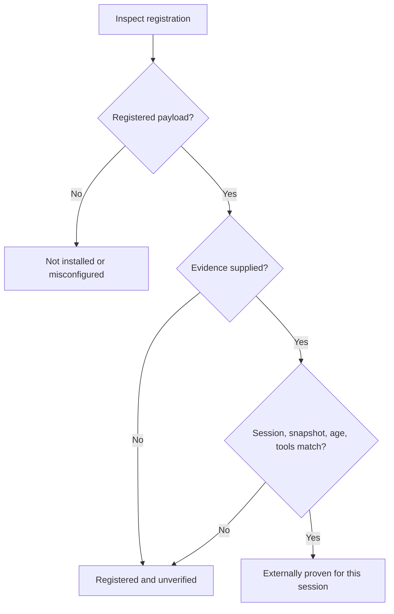

# External Codex discovery evidence

Doctor keeps three proof gates separate: CLI/setup health (`health` and `loop`), plugin
registration (`loop.integrations.codex.registered`), and discovery plus callability in an
externally observed host session (`loop.integrations.codex.discovery`). Installation metadata
and the packaged MCP self-test cannot prove the third gate. Calling `fclt_doctor` does not
automatically produce proof about the host's tool registry.




## Observer and caller contract

A host integration, agent with direct access to the current session's typed tools, or human
operator may assert an observation. The caller must trust that observer and independently
supply the expected host session ID. Doctor cannot authenticate either identity, interrogate
the host registry, or establish that a caller-supplied session ID belongs to its current
process. This is a validated external assertion, not an authenticated attestation.

The observer must:

1. Obtain `loop.integrations.codex.discovery.installationFingerprint` from `fclt doctor --json`.
2. Confirm the observed host session uses the inspected `~/plugins/fclt` payload and
   `~/.codex/config.toml` configuration. Codex may load a separate cached payload; the observer
   must establish that it corresponds to this snapshot. A different tool home or unknown
   cached payload cannot be asserted from this fingerprint alone.
3. In a fresh session started after that installation/configuration, discover both
   `fclt_status` and `fclt_setup`, then successfully call the read-only `fclt_status` tool.
   Listing tools, invoking the CLI, running a server self-test, or calling only doctor is
   insufficient.
4. Write the record below to a caller-controlled file outside the plugin tree, using the
   actual session ID, snapshot fingerprint, and observation completion time. Do not include
   tool results, credentials, transcripts, or private data in the record.
5. Pass that file explicitly for each doctor invocation, along with the expected session ID.
   If the observer cannot establish the session or loaded snapshot, omit the evidence.

```json
{
  "version": 1,
  "source": "external_session_observer",
  "observer": "host session observer",
  "sessionId": "current-host-session-id",
  "observedAt": "2026-01-01T12:00:00.000Z",
  "installationFingerprint": "sha256:<fingerprint from doctor>",
  "discoveredTools": ["fclt_status", "fclt_setup"],
  "successfulTools": ["fclt_status"]
}
```

```bash
fclt doctor --json \
  --codex-discovery-evidence /path/to/session-proof.json \
  --codex-session current-host-session-id
```

Both flags also accept `--flag=value`. These inputs are supported only with `doctor --json`;
repair remains a separate operation. The MCP `fclt_doctor` tool forwards optional
`codexDiscoveryEvidencePath` and `codexSessionId` arguments to these flags. Relative evidence
paths resolve from the command's working directory (`cwd` for the MCP tool). The MCP bridge
does not create or amend proof files.

## Binding and invalidation

Fingerprint version 1 hashes the absolute inspected home path, the SHA-256 of the raw
`~/.codex/config.toml` bytes, and the ordered relative names and content hashes of all regular
files under `~/plugins/fclt`. Neither configuration contents nor file contents appear in the
report. Any file addition, removal, content change, configuration-byte change, or home-path
change invalidates evidence. Runtime identity outside those paths is the observer's
responsibility; this snapshot does not establish the selected CLI executable or a loaded
process's identity. The CLI health gate remains independent.

The observation must be at most one hour old, must not be in the future, and must use UTC ISO
time with milliseconds (`new Date().toISOString()`). A matching session ID is required on
every invocation. Age expiry limits accidental reuse; it does not detect a session ending
early, a host registry change, or a dishonest observer. Recheck after such changes. Doctor
does not persist, reuse, or discover evidence automatically. Omitting it returns to the
unverified state immediately.

Unreadable/malformed/oversized evidence, a wrong session, a changed fingerprint, stale or
future timestamps, and missing tool proof are rejected. Evidence files must be regular
files no larger than 16 KiB. Snapshot inspection fails closed for symlinks or special files,
more than 1,024 payload entries, over 32 MiB of payload files, or configuration over 1 MiB.
These limits affect proof acceptance, not registration detection. Failure reasons appear in
`discovery.reason`; rejected records are not echoed.

## JSON compatibility

The doctor report remains version 2. Existing fields and enum values are preserved;
`discovery` is an additive object. Without proof, a registered installation still reports
`state: "registered_unverified"` and `freshSessionDiscovery: "requires_fresh_session"`.
The explanatory `repair` text now describes an unassessed runtime gate, not failed
registration.

Accepted evidence uses the already defined `state: "ready"` and
`freshSessionDiscovery: "not_applicable"`, omits the discovery repair instruction, and adds
`discovery.state: "externally_proven"` plus the observer, session, and observation time under
`discovery.proof`. This readiness applies only to the externally asserted Codex session; it
does not change CLI health, loop readiness, or registration facts. Rejected evidence leaves
the legacy registration state intact and adds `discovery.state: "rejected"` with a reason.
